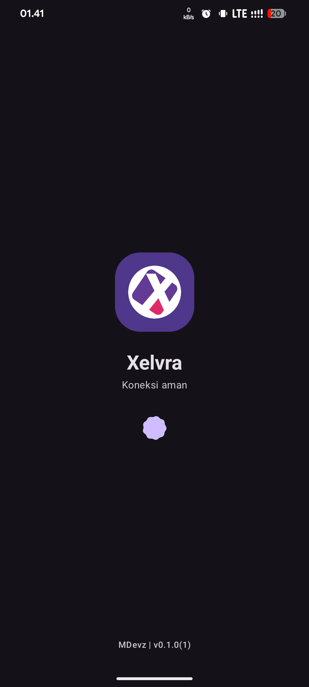
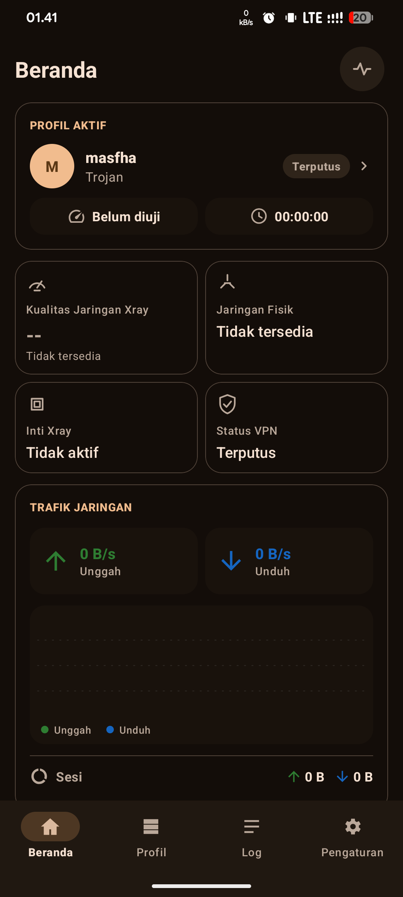
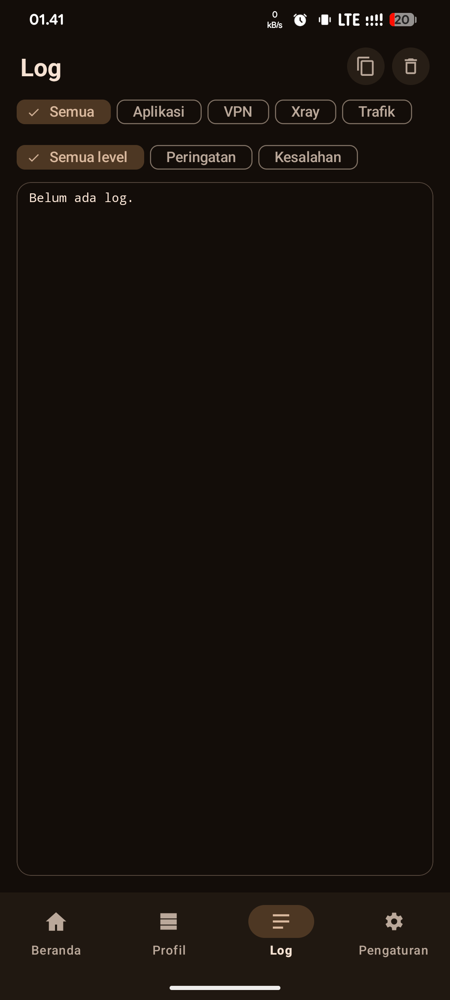
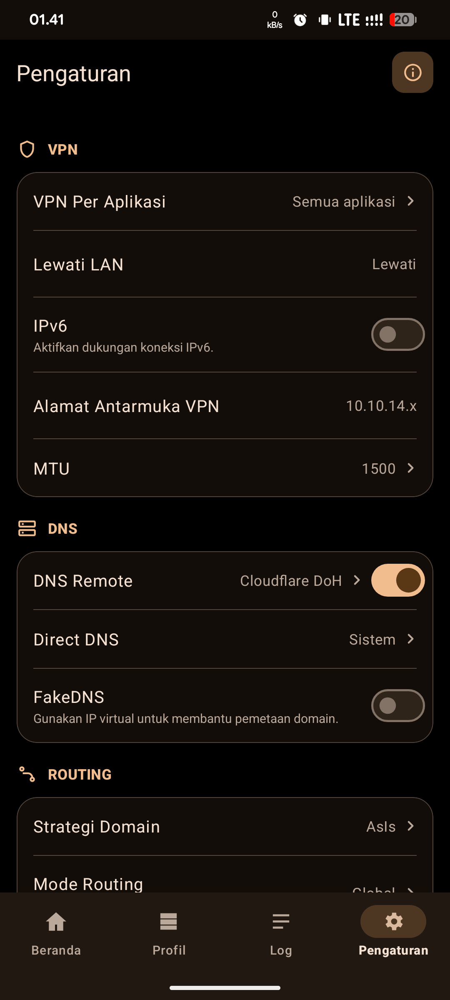

# Xelvra

**An Android VPN client built with Kotlin and powered by an embedded Xray runtime.**

   

> **Development status:** Xelvra is a work in progress. This document describes components confirmed in the source inventory; it does **not** claim that every protocol, transport, server configuration, or Android device has passed end-to-end testing.

## Contents

- [Overview](#overview)
- [Technical specifications](#technical-specifications)
- [Features and implementation](#features-and-implementation)
- [Architecture](#architecture)
- [Project layout](#project-layout)
- [Requirements and build](#requirements-and-build)
- [Usage](#usage)
- [Security and privacy](#security-and-privacy)
- [Testing and troubleshooting](#testing-and-troubleshooting)
- [Limitations](#limitations)
- [Acknowledgements and licensing](#acknowledgements-and-licensing)

## Overview

Xelvra is a native Android application integrating Android's `VpnService` API with an Xray-based runtime supplied through `app/libs/libv2ray.aar`. Its codebase separates VPN lifecycle management, Xray configuration and assets, server profiles, routing rules, diagnostics, and user interface concerns.

The project is intended for **non-rooted Android devices**. Root access is not a product requirement.

## Technical specifications

| Item | Configuration observed in source |
| --- | --- |
| Application ID / namespace | `com.mdevz.xelvra` |
| Version name / code | `0.1.0` / `1` |
| Minimum SDK | API 24 (Android 7.0) |
| Target / compile SDK | API 36 / API 36 |
| Language | Kotlin; Java 17 compatibility and JVM target 17 |
| Android Gradle Plugin | `8.13.0` |
| Kotlin Gradle plugin | `2.1.20` |
| Gradle wrapper | `9.0.0` |
| Android module | `:app` |
| Configured native ABIs | `armeabi-v7a`, `arm64-v8a` |
| Xray integration | Bundled `app/libs/libv2ray.aar` (approximately 32.4 MiB in the inspected revision) |
| UI dependencies | AndroidX AppCompat, Activity, Fragment, RecyclerView, ConstraintLayout, Material Components |

These values reflect the inspected source revision and may change in later commits.

## Features and implementation

### VPN lifecycle and Xray runtime

- `XelvraVpnService` extends Android `VpnService` and coordinates the application's VPN lifecycle.
- `VpnRuntimeManager` and `VpnRuntimeState` provide supporting runtime management/state components.
- `BootReceiver` is declared in the Android manifest. Its presence does not by itself guarantee automatic reconnection on every device.
- `XrayConfigBuilder`, `XrayRuntimeController`, and `XrayCoreManager` cover configuration and runtime integration.
- `XrayAssetManager`, `XrayAssetCoordinator`, and `AssetMetadataStore` cover Xray asset handling.

### Profile handling

The source contains profile models, URI conversion, validation, persistence, and repository components:

- `ServerProfile`, `ProfileValidator`, `ProfileUriCodec`
- `ProfileJsonCodec`, `ProfileLocalStorage`, `ProfileRepository`
- `ActiveProfileStore`

The URI and validation implementations contain code paths for **VMess, VLESS, Trojan, and Shadowsocks**. The profile security model and validator also include **REALITY** fields, including public key and short ID. TLS-related settings appear in the Xray configuration layer.

**Compatibility scope:** These are verified code-level capabilities, not a guarantee of successful connections across all transports, security combinations, or server implementations.

### Routing and application selection

- The configuration builder references `GLOBAL`, `BYPASS_PRIVATE`, and `BLOCK_ADS` routing modes.
- `SmartRoutingActivity`, `SmartRoutingRuleCodec`, and `SmartRoutingValidator` implement interfaces and validation for user-defined routing rules.
- `PerAppVpnActivity` and related settings provide a per-app VPN configuration surface.
- Routing outcomes can depend on runtime configuration, Android behavior, and available GeoIP/Geosite assets.

### Diagnostics and interface

The project contains modules for endpoint latency testing, delay monitoring, traffic information, logs, crash handling, theme management, and connection diagnostics. The UI includes profile editing, routing, per-app VPN, asset-file, and log screens.

The existence of these modules should not be interpreted as an independently verified quality, accuracy, or performance claim.

## Architecture

```text
Android UI (activities, fragments, settings)
                  |
          Profiles and settings
                  |
      Validation / URI / local storage
                  |
         Xray configuration builder
                  |
        Xray runtime integration
                  |
       Android VpnService lifecycle
                  |
         Android networking stack
```

This is a conceptual component diagram, not an exact call graph. The codebase groups responsibilities under `core`, `data`, `network`, `protocol`, and `ui` packages.

## Project layout

```text
Xelvra/
├── app/
│   ├── libs/libv2ray.aar
│   ├── src/main/
│   │   ├── AndroidManifest.xml
│   │   └── java/com/mdevz/xelvra/
│   │       ├── core/
│   │       │   ├── crash/ diagnostics/ log/ theme/ traffic/
│   │       │   ├── vpn/
│   │       │   └── xray/config/
│   │       ├── data/local/ model/ repository/
│   │       ├── network/latency/
│   │       ├── protocol/uri/ validator/
│   │       └── ui/
│   └── build.gradle.kts
├── gradle/wrapper/
├── build.gradle.kts
├── settings.gradle.kts
├── gradlew
├── gradlew.bat
└── README.md
```

## Requirements and build

**Device:** Android 7.0 or later, a compatible CPU architecture, VPN permission granted by the user, and a working server configuration. Root access is not required.

**Build environment:** JDK 17, Android SDK platform 36, a correctly configured Android SDK, and access to required Gradle dependencies. The bundled `libv2ray.aar` must be present.

From the project root on a suitably configured development machine:

```bash
./gradlew :app:assembleDebug --no-daemon --console=plain
```

A successful debug build normally produces:

```text
app/build/outputs/apk/debug/app-debug.apk
```

The project's Termux development workflow also uses a locally configured `xelvra-build` helper. **That helper is not part of the standard Gradle toolchain**, and it should not be assumed to exist on another machine. Building inside Termux may require environment-specific configuration.

**Signing:** Android requires APK signing. To update an installed Xelvra app without removing its data, the replacement APK must retain a compatible application ID and signing identity. Do not uninstall or clear app data as part of an ordinary update workflow.

## Usage

1. Install a compatible signed APK.
2. Open Xelvra and create or import a compatible server profile.
3. Review the profile and select it.
4. Adjust routing and per-app settings if needed.
5. Start the VPN and approve the Android VPN permission prompt.
6. Check connection status, logs, or diagnostics as needed.

Connection success depends on the selected server, profile settings, Android device, and network. This workflow describes intended use, not a certification that every step works in every environment.

## Security and privacy

- VPN operation uses Android's VPN permission and service mechanisms.
- Profile storage uses application-local files; some preferences use Android `SharedPreferences`.
- Profiles, server addresses, credentials, exported configurations, logs, and backups may contain sensitive information. Handle them accordingly.
- Do not commit signing keys, secrets, personal profiles, local build configuration, or generated APKs. `.gitignore` helps prevent accidental staging but is **not** a security audit.
- No independent security audit, zero-logging guarantee, anonymity guarantee, or external privacy certification is claimed here.
- Actual privacy properties depend on the application configuration, Xray runtime, remote endpoint, and network environment.

## Testing and troubleshooting

The Gradle configuration includes JUnit `4.13.2` and `org.json:json:20240303` for local tests. In a configured build environment, run:

```bash
./gradlew :app:testDebugUnitTest --no-daemon --console=plain
```

No current test-pass count or CI status is asserted by this README.

If a build fails, inspect the **full Gradle output**, installed SDK platform, JDK version, dependency availability, and bundled AAR. If a connection fails, check the profile fields, server reachability, VPN permission, Xray assets, and application logs. Avoid posting unredacted profiles or credentials when sharing diagnostics.

## Limitations

- Xelvra is under development; features and interfaces may change.
- End-to-end protocol compatibility and performance benchmarks are not documented as verified results.
- Some routing behavior depends on GeoIP/Geosite assets and selected settings.
- Android background-service and VPN restrictions differ by device and OS version.
- A successful APK build does not establish that all connections will work.
- No public release, automated CI badge, or external audit is claimed in this document.

## Acknowledgements and licensing

Xelvra integrates Xray technology and draws architectural inspiration from the Android Xray-client ecosystem, including [Xray-core](https://github.com/XTLS/Xray-core) and [v2rayNG](https://github.com/2dust/v2rayNG). This does not imply endorsement or affiliation.

Third-party components retain their own license obligations. **No project-level license is declared here**; do not assume redistribution or relicensing rights merely because source files are available to repository collaborators.

---

**Repository:** [MasFha/Xelvra](https://github.com/MasFha/Xelvra) · **Package:** `com.mdevz.xelvra` · **Version:** `0.1.0` · **Status:** In development

## App Screenshots

<table>
  <tr>
    <th>Launcher</th>
    <th>Home</th>
    <th>Log</th>
    <th>Settings</th>
  </tr>
  <tr>
    <td align="center"></td>
    <td align="center"></td>
    <td align="center"></td>
    <td align="center"></td>
  </tr>
</table>
